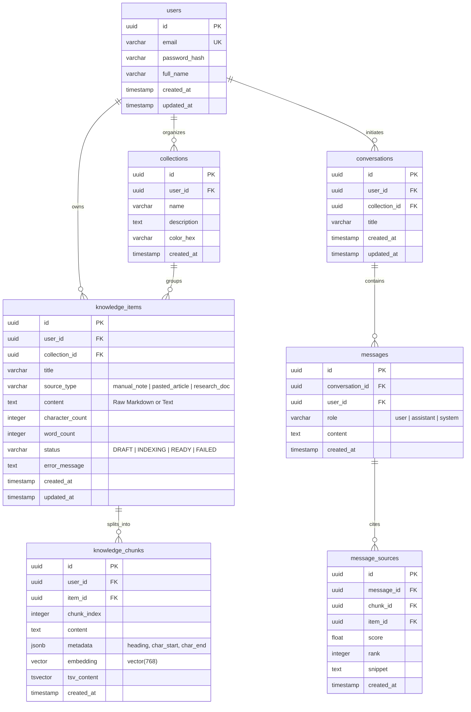
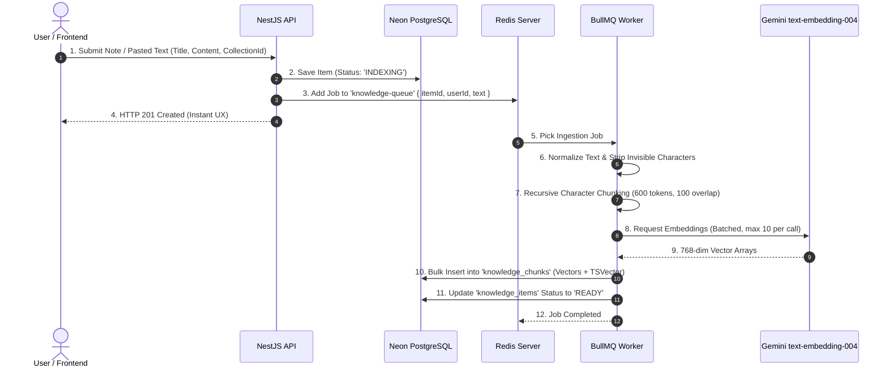

# MindVault AI — টেকনিক্যাল আর্কিটেকচার এবং ইমপ্লিমেন্টেশন ব্লুপ্রিন্ট (আপডেটেড)
> **A Grounded, Citation-Backed Personal Knowledge Vault powered by RAG**  
> *প্রজেক্ট স্ট্যাটাস:* প্ল্যানিং ও আর্কিটেকচার ডিজাইন ফেজ (Text-First Architecture + Redis & BullMQ)  
> *প্রযুক্তিগত ফ্রেমওয়ার্ক:* Monorepo (pnpm + Turborepo), Next.js 16.4, NestJS, Node.js v22 LTS, Neon PostgreSQL (pgvector + FTS), Redis + BullMQ, Google Gemini API

---

## ১. প্রোডাক্ট পরিচিতি ও আর্কিটেকচারাল পরিবর্তন (Product Vision & Updates)

**MindVault AI** হলো একটি পারসোনাল নলেজ ম্যানেজমেন্ট (PKM) ও গ্রাউন্ডেড রিট্রিভাল-অগমেন্টেড জেনারেশন (RAG) প্ল্যাটফর্ম। 

### মূল আর্কিটেকচারাল আপডেট:
1. **টেক্সট-ফার্স্ট অ্যাপ্রোচ (Text-First Knowledge Ingestion):**
   - কোনো বাহ্যিক ফাইল আপলোডের (PDF/DOCX) ঝামেলা নেই; ব্যবহারকারী সরাসরি Markdown নোট লিখতে পারবেন, গবেষণাপত্র বা বইয়ের অধ্যায় কপি-পেস্ট করতে পারবেন, অথবা বড় টেক্সট ইনপুট দিতে পারবেন।
   - **Cloudflare R2 বা কোনো বাহ্যিক S3 অবজেক্ট স্টোরেজ সম্পূর্ণ অপ্রয়োজনীয়।** সমস্ত মূল কনটেন্ট সরাসরি PostgreSQL-এর `knowledge_items` টেবিলে সংরক্ষিত থাকবে। এটি ক্লাউড ডিপ্লয়মেন্টকে অত্যন্ত সহজ এবং সম্পূর্ণ জিরো-কনফিগারেশন করে তোলে।
2. **ডিস্ট্রিবিউটেড টাস্ক কিউ (Redis + BullMQ):**
   - টেক্সট ইনপুটের ক্ষেত্রেও ব্যাকগ্রাউন্ড প্রসেসিং নিশ্চিত করার জন্য **Redis + BullMQ** ব্যবহার করা হবে।
   - ব্যবহারকারী হাজার হাজার শব্দের আর্টিকেল পেস্ট করলেও ওয়েব সার্ভার ব্লক হবে না (<৫০ms রেসপন্স টাইম)। ব্যাকগ্রাউন্ডে BullMQ Worker টেক্সট চাঙ্কিং, Gemini রেট-লিমিট কন্ট্রোল ও ভেক্টর এমবেডিং তৈরি করবে।
3. **কোর RAG প্রিন্সিপাল:**
   - ব্যবহারকারীর নিজস্ব সংরক্ষিত নলেজের বাইরে মনগড়া কোনো তথ্য দেওয়া সম্পূর্ণ নিষিদ্ধ (Zero Hallucination)।
   - প্রতিটি তথ্যের পেছনে নির্দিষ্ট নোটের অনুচ্ছেদ বা লাইনের সাইটেশন (Citation) থাকবে।
   - তথ্য না থাকলে স্পষ্ট অক্ষমতা প্রকাশ (Strict Abstention: *"সংরক্ষিত তথ্যের ভিত্তিতে উত্তর নেই"* )।

---

## ২. চূড়ান্ত রিকমেন্ডেড টেকনোলজি স্ট্যাক (Technology Stack)

```
mindvault-ai/ (Monorepo Root)
├── apps/
│   ├── api/        # NestJS Backend (Node.js 22 LTS, REST, Swagger, BullMQ Workers)
│   └── web/        # Next.js 16.4 Frontend (React 19, Tailwind CSS, shadcn/ui)
├── packages/
│   ├── shared/     # Shared DTOs, TypeScript interfaces, validation schemas
│   ├── database/   # Database schemas, migrations (Drizzle ORM), seeders
│   ├── tsconfig/   # Base TypeScript configurations
│   └── eslint-config/ # Shared linting rules
├── docker/         # Docker Compose for local PostgreSQL (pgvector) + Redis
├── pnpm-workspace.yaml
├── turbo.json
└── package.json
```

### ফ্রন্টএন্ড (Frontend):
- **ফ্রেমওয়ার্ক:** **Next.js 16.4** (App Router, Server Components, React 19)।
- **স্টাইলিং ও ইউআই:** **Tailwind CSS v4** + **shadcn/ui** (Accessible Radix Primitives)।
- **স্টেট ও ক্যাশিং:** **TanStack Query v5** (সার্ভার স্টেট ও অটো-রিফ্রেশিং প্রসেসিং স্ট্যাটাস), **Zustand** (লোকাল UI স্টেট)।
- **স্ট্রিমিং চ্যাট:** **Vercel AI SDK (`@ai-sdk/react`)** অথবা নেটিভ Server-Sent Events (SSE) স্ট্রিম।
- **রিচ টেক্সট এডিটর:** **Tiptap** বা **MDX Editor** (নোটস ও আর্টিকেল লেখার জন্য)।

### ব্যাকএন্ড (Backend):
- **ফ্রেমওয়ার্ক:** **NestJS v10+** (Node.js 22 LTS, Modular Monolith)।
- **API স্টাইল:** RESTful API + OpenAPI (Swagger)।
- **টাস্ক কিউ ও ব্যাকগ্রাউন্ড প্রসেসিং:** **BullMQ v5** + **Redis** (`ioredis`)।
- **ভ্যালিডেশন ও সিকিউরিটি:** `class-validator`, `class-transformer`, `helmet`, `@nestjs/throttler`, `bcrypt`।

### ডেটাবেজ ও ভেক্টর স্টোরেজ:
- **ডেটাবেজ:** **PostgreSQL 16+** (Hosted on **Neon Free Tier**)।
- **ভেক্টর এক্সটেনশন:** **pgvector** (Cosine Distance `<=>`, HNSW ইনডেক্সিং)।
- **ফুল-টেক্সট সার্চ:** PostgreSQL নেটিভ **Full-Text Search (`tsvector`, `tsquery`, GIN Index)**।
- **ORM:** **Drizzle ORM** (সুপার লাইটওয়েট, টাইপ-সেফ, নেটিভ pgvector কোয়েরি সাপোর্ট)।

### এআই ও এমবেডিংস (AI Layer):
- **LLM চ্যাট মডেল:** **Google Gemini API Free Tier** (`gemini-2.0-flash` / `gemini-1.5-flash`)।
- **ভেক্টর এমবেডিং মডেল:** **Google `text-embedding-004`** (৭৬৮ ডাইমেনশন)।
- **লোকাল ফলব্যাক:** `@xenova/transformers` (`all-MiniLM-L6-v2` - Node.js লোকাল মেমোরি ফলব্যাক)।

---

## ৩. ফ্রি-টিয়ার ইনফ্রাস্ট্রাকচার বিশ্লেষণ (Free-Tier Architecture)

| সার্ভিস | রোল / কম্পোনেন্ট | ফ্রি-টিয়ার কোটা | সীমাবদ্ধতা ও চ্যালেঞ্জ | সমাধান ও মিটিগেশন |
| :--- | :--- | :--- | :--- | :--- |
| **Neon** | PostgreSQL + pgvector + FTS | 0.5 GB স্টোরেজ, সার্ভারলেস ব্র্যাঞ্চিং | ৫ মিনিট পর Compute অটো-সাসপেন্ড হয় (Cold start ~500ms) | Neon Connection Pooling ব্যবহার করা। ০.৫ জিবি-তে শুধু টেক্সটের ক্ষেত্রে প্রায় ১,০০,০০০+ চাঙ্ক সংরক্ষণ সম্ভব! |
| **Aiven / Redis** | BullMQ Task Queue | 1 Free Project (Aiven Redis) অথবা Upstash | Upstash-এ দৈনিক ১০k কমান্ডের লিমিট থাকে যা BullMQ পোলিং দ্রুত শেষ করে | **Aiven Free Redis** ব্যবহার করা (কোনো কৃত্রিম দৈনিক কমান্ড লিমিট নেই)। লোকাল ডেভে Docker Redis। |
| **Render** | NestJS Backend API + Worker | 512 MB RAM, Shared CPU | ১৫ মিনিট পর Instance Sleep (Cold start ৫০-৯০ সেকেন্ড) | ফ্রন্টএন্ডে একটি "Server waking up..." ইউজার ফ্রেন্ডলি লোডার রাখা। অথবা ফ্রি ক্রন পিং দিয়ে ওয়েক রাখা। |
| **Vercel** | Next.js 16.4 Frontend Hosting | 100 GB ব্যান্ডউইথ | Serverless Function Timeout ১০ সেকেন্ড | কোনো ভারি কাজ Vercel-এ চলবে না; শুধুমাত্র পেজ রেন্ডারিং ও ক্লায়েন্ট রিকোয়েস্ট রাউটিং। |
| **Google Gemini API** | LLM Generation & Vector Embedding | 15 RPM, 1M TPM, 1,500 RPD | কনকারেন্ট রিকোয়েস্টে 429 Rate Limit এরর | BullMQ-এর ভেতরে Concurrency কন্ট্রোল (`limiter: { max: 10, duration: 60000 }`) এবং এক্সপোনেনশিয়াল ব্যাকঅফ। |

---

## ৪. সিস্টেম হাই-লেভেল আর্কিটেকচার (System Architecture)

```mermaid
flowchart TD
    subgraph Client ["Client Layer (Browser)"]
        UI["Next.js 16.4 App Router\n(Tailwind CSS + shadcn/ui)"]
    end

    subgraph CDN ["Edge Layer"]
        Vercel["Vercel Frontend Hosting"]
    end

    subgraph Backend ["Backend Monolith (Render - NestJS)"]
        NestAPI["NestJS REST Controllers\n(Auth, Notes, Knowledge, Chat)"]
        QueueProducer["BullMQ Job Producer\n(Dispatch 'ingest-text')"]
        QueueWorker["BullMQ Worker Service\n(Chunking, Embedding, Indexing)"]
        RAGService["Hybrid Search & RRF Engine"]
    end

    subgraph Storage ["Persistent & In-Memory Storage"]
        NeonDB[("Neon PostgreSQL 16\n- knowledge_items\n- knowledge_chunks (pgvector + FTS)\n- users & chats")]
        RedisDB[("Redis (Aiven / Local Docker)\n- BullMQ Job Queues & Retries")]
    end

    subgraph ExternalAI ["Google AI Free Tier"]
        GeminiEmbed["Google text-embedding-004\n(768 Dimension Vectors)"]
        GeminiLLM["Google Gemini 2.0/1.5 Flash\n(Streaming Grounded Answers)"]
    end

    UI --> Vercel
    UI -->|REST API & SSE Streams| NestAPI
    NestAPI -->|Instant Save Draft/Raw Text| NeonDB
    NestAPI -->|Push Ingestion Task| QueueProducer
    QueueProducer --> RedisDB
    RedisDB --> QueueWorker
    QueueWorker -->|1. Clean & Recursive Chunk| QueueWorker
    QueueWorker -->|2. Batch Vectors (Max 10)| GeminiEmbed
    QueueWorker -->|3. Store Vectors & FTS| NeonDB
    NestAPI -->|Query Hybrid Search| RAGService
    RAGService -->|Vector <=> & BM25 FTS| NeonDB
    RAGService -->|Grounded Prompt Context| GeminiLLM
    GeminiLLM -->|Stream Tokens & Citations| NestAPI
    NestAPI -->|SSE Event Stream| UI
```

---

## ৫. হালনাগাদকৃত ডেটাবেজ স্কিমা (Updated Database Schema)



### বিশেষ ইনডেক্স ও সিকিউরিটি কনস্ট্রেইন্ট:
```sql
-- ১. pgvector HNSW ইনডেক্স (Cosine Distance)
CREATE INDEX idx_chunks_embedding_hnsw 
ON knowledge_chunks 
USING hnsw (embedding vector_cosine_ops)
WITH (m = 16, ef_construction = 64);

-- ২. PostgreSQL Full-Text Search (GIN) ইনডেক্স
CREATE INDEX idx_chunks_tsv 
ON knowledge_chunks 
USING gin(tsv_content);

-- ৩. মাল্টি-টেন্যান্ট আইসোলেশন ইনডেক্স
CREATE INDEX idx_chunks_user_item 
ON knowledge_chunks (user_id, item_id);
```

---

## ৬. ব্যাকএন্ড মডিউল এবং API আর্কিটেকচার (NestJS)

```
apps/api/src/
├── app.module.ts
├── main.ts
├── common/
│   ├── decorators/      # CurrentUser, Public
│   ├── filters/         # GlobalHttpExceptionFilter
│   ├── guards/          # JwtAuthGuard, ThrottlerGuard
│   └── interceptors/    # LoggingInterceptor, ResponseTransform
├── modules/
│   ├── auth/            # Register, Login, JWT Strategy
│   ├── users/           # User management
│   ├── collections/     # Collections CRUD
│   ├── knowledge/       # Text & Notes CRUD (triggers BullMQ)
│   ├── queue/           # BullMQ Module (Producer, Consumer Worker)
│   ├── chunker/         # Markdown & Semantic Text Splitting logic
│   ├── ai-provider/     # Gemini LLM & Embedding Service
│   ├── retrieval/       # Vector Search, FTS, Reciprocal Rank Fusion (RRF)
│   └── chat/            # Streaming RAG Chat Controller & SSE service
```

### প্রধান API এন্ডপয়েন্টসমূহ:
1. `POST /api/v1/auth/register` & `login`: প্রমাণীকরণ ও JWT টোকেন।
2. `POST /api/v1/collections`: ক্যাটাগরি তৈরি (যেমন: "React & Next.js", "AI Architecture")।
3. `POST /api/v1/knowledge`: নতুন নোট বা আর্টিকেল সেভ করা।
   - **ফলাফল:** সাথে সাথে `status: "INDEXING"` রিটার্ন করে এবং BullMQ-তে `ingest-knowledge` জব পুশ করে।
4. `GET /api/v1/knowledge/:id/status`: ইনডেক্সিং শেষ হয়েছে কি না তা চেক করা (`INDEXING` -> `READY`)।
5. `DELETE /api/v1/knowledge/:id`: নোট ও তার সংশ্লিষ্ট সকল ভেক্টর চাঙ্ক স্বয়ংক্রিয়ভাবে মোছা।
6. `POST /api/v1/chat/conversations/:id/messages`: প্রশ্ন পাঠানো এবং লাইভ SSE স্ট্রিমিংয়ে সাইটেশনসহ উত্তর গ্রহণ।

---

## ৭. টেক্সট ইনজেশন ও প্রসেসিং পাইপলাইন (Text Ingestion Flow)



---

## ৮. হাইব্রিড রিট্রিভাল ও সাইটেশন মেকানিজম (Hybrid Retrieval & Citations)

1. **কুয়েরি রিসিভ:** ব্যবহারকারীর প্রশ্ন এলে একই সাথে:
   - Gemini Embedding API দিয়ে প্রশ্নের ভেক্টর (৭৬৮-ডাইমেনশন) তৈরি করা হয়।
   - PostgreSQL-এর জন্য `websearch_to_tsquery` কি-ওয়ার্ড কোয়েরি প্রস্তুত করা হয়।
2. **ডুয়াল এক্সিকিউশন:**
   - HNSW ভেক্টর ইনডেক্স ব্যবহার করে কোসাইন সিমিলারিটির শীর্ষ ২০টি চাঙ্ক খোঁজা হয়।
   - GIN ইনডেক্স ব্যবহার করে `ts_rank_cd` দিয়ে কি-ওয়ার্ডের শীর্ষ ২০টি চাঙ্ক খোঁজা হয়।
3. **Reciprocal Rank Fusion (RRF):**
   $$RRF\_Score(d) = \frac{1}{60 + Rank_{vec}(d)} + \frac{1}{60 + Rank_{fts}(d)}$$
   উভয় সার্চের র‍্যাংক কম্বাইন করে টপ ৫টি সেরা চাঙ্ক নির্বাচন করা হয়।
4. **কনফিডেন্স গার্ডরেইল ও অ্যাবস্টেনশন (Strict Abstention):**
   - যদি টপ চাঙ্কের সিমিলারিটি স্কোর নির্ধারিত থ্রেশহোল্ডের নিচে হয়, তবে LLM-কে কল না করেই সরাসরি রিটার্ন করা হবে:  
     *"আমার কাছে সংরক্ষিত তথ্যের ভিত্তিতে এই প্রশ্নের উত্তর দেওয়া সম্ভব নয়।"*
5. **গ্রাউন্ডেড স্ট্রিমিং ও সাইটেশন ম্যাপিং:**
   - নির্বাচিত চাঙ্কগুলো `<knowledge_context>` ট্যাগে আবদ্ধ করে Gemini Flash-কে প্রম্পট দেওয়া হয়।
   - জেনারেটেড উত্তরের লাইনে যেখানে যেখানে `[Source 1]` থাকবে, ফ্রন্টএন্ড সেখানে ক্লিকেবল চিপ/পিল রেন্ডার করবে, যাতে ক্লিক করলেই ডানদিকের সোর্স প্যানেলে মূল নোটের সংশ্লিষ্ট অংশ হাইলাইট হয়ে যায়।

---

## ৯. ফ্রন্টএন্ড UI/UX ডিজাইন (Next.js 16.4)

Next.js 16.4 App Router-এর মাধ্যমে ৩-প্যানেল ড্যাশবোর্ড:
1. **বাম সাইডবার (Navigation):** কালেকশন লিস্ট, রিসেন্ট চ্যাটস, নলেজ লাইব্রেরি।
2. **মাঝের মেইন স্ক্রিন (Editor / Chat):**
   - **নলেজ ক্রিয়েটর মোড:** টাইটেল, কালেকশন সিলেক্টর, এবং রিচ Markdown এডিটর (বা বড় টেক্সট পেস্ট করার টেক্সটএরিয়া) সহ ওয়ার্ড/ক্যারেক্টার কাউন্টার।
   - **চ্যাট মোড:** লাইভ স্ট্রিমিং মেসেজ বাবলস, প্রম্পট ইনপুট এবং কালেকশন স্কোপ ড্রপডাউন।
3. **ডান সাইডবার (Citation & Source Inspector):**
   - চ্যাটে কোনো সাইটেশনে ক্লিক করলে এই প্যানেলটি খুলে যাবে এবং মূল নোটের যে প্যারাগ্রাফ থেকে উত্তরটি তৈরি হয়েছে তা সরাসরি প্রদর্শন করবে।

---

## ১০. প্রায়োরিটাইজড বাস্তবায়ন রোডম্যাপ (Phased Roadmap)

- **Phase 1: Project Foundation (Monorepo Setup)**
  - pnpm workspace, Turborepo, Next.js 16.4, NestJS (Node 22 LTS), shared package, Docker compose (PostgreSQL + pgvector + Redis)।
- **Phase 2: Database & Authentication**
  - Neon PostgreSQL ইন্টিগ্রেশন, Drizzle ORM স্কিমা মাইগ্রেশন, JWT Auth Module, User Registration/Login।
- **Phase 3: Knowledge Items & Collections (Text-First)**
  - Collections CRUD, Knowledge Items CRUD (নোটস ও পেস্টেড টেক্সট এন্ট্রি)।
- **Phase 4: Redis + BullMQ Background Ingestion Pipeline**
  - BullMQ Queue & Worker সেটআপ, রিকার্সিভ ক্যারেক্টার চাঙ্কার সার্ভিস, এরর হ্যান্ডলিং ও এক্সপোনেনশিয়াল ব্যাকঅফ।
- **Phase 5: Embeddings & pgvector Hybrid Search**
  - Google Gemini `text-embedding-004` ব্যাচ সার্ভিস, HNSW ভেক্টর ইনডেক্সিং, PostgreSQL FTS এবং Reciprocal Rank Fusion (RRF)।
- **Phase 6: RAG Chat Engine & Citations**
  - গ্রাউন্ডেড প্রম্পট বিল্ডার, প্রম্পট ইনজেকশন ডিফেন্স, Gemini 2.0/1.5 Flash SSE স্ট্রিমিং, সোর্স সাইটেশন মেটাডেটা।
- **Phase 7: Next.js 16.4 Frontend Integration**
  - ৩-প্যানেল ড্যাশবোর্ড, Markdown এডিটর, রিয়েল-টাইম স্ট্রিমিং চ্যাট, সাইটেশন সোর্স ড্রয়ার।
- **Phase 8: Security, Quality & Zero-Cost RAG Evaluation**
  - ৩০টি টেস্ট কেসের গোল্ডেন ইভ্যালুয়েশন স্ক্রিপ্ট (Recall@K, Faithfulness, Abstention Accuracy), রেট লিমিট অডিট।
- **Phase 9: Free Cloud Deployment & Portfolio Polish**
  - Vercel (Frontend), Render (Backend), Neon (DB), Aiven (Redis) ডিপ্লয়মেন্ট, আর্কিটেকচার ডায়াগ্রামসহ পেশাদার GitHub README।

---

## ১১. পরবর্তী পদক্ষেপ (Next Action)

প্ল্যানটি আপনার সিদ্ধান্ত অনুযায়ী সম্পূর্ণ আপডেট করা হয়েছে। আপনি সম্মতি দিলেই আমরা **Phase 1: Project Foundation (Monorepo Setup with Next.js 16.4, NestJS on Node 22 LTS, Redis & PostgreSQL Docker Setup)** শুরু করতে প্রস্তুত।
